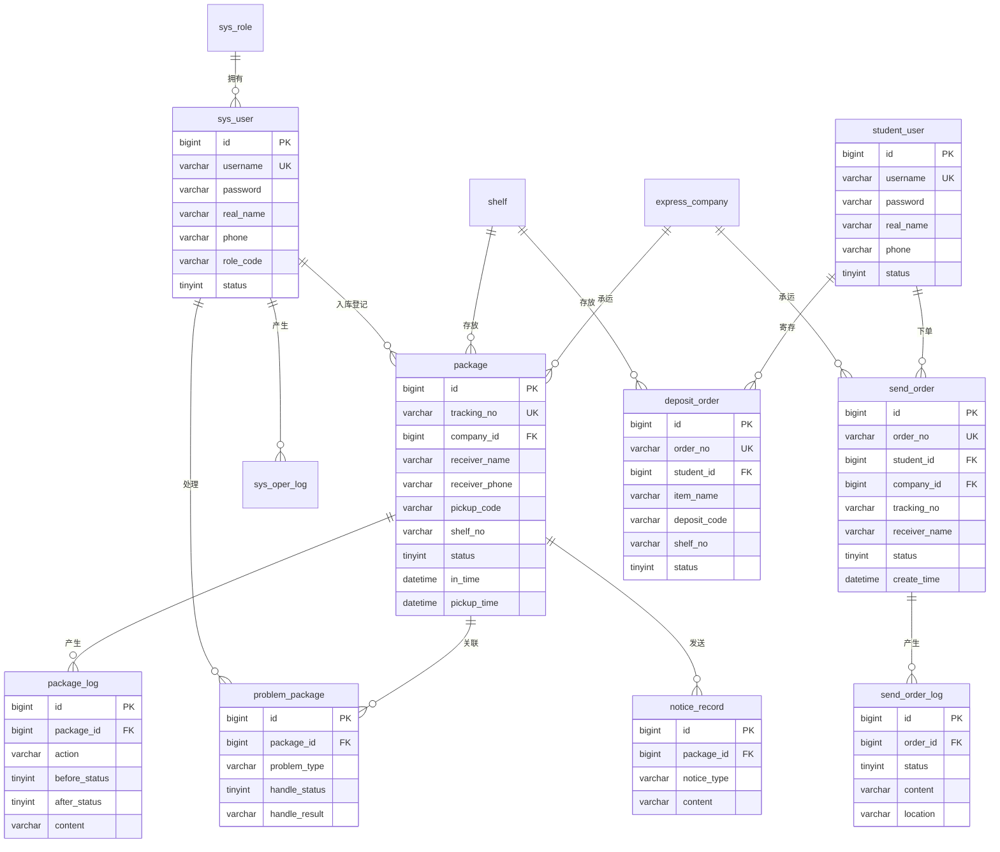

# 校园快递驿站管理系统 数据库设计

数据库名：`campus_express`（utf8mb4）

## 1. 表清单

| 序号 | 表名 | 说明 |
| --- | --- | --- |
| 1 | sys_role | 角色表 |
| 2 | sys_user | 用户（管理员/员工）表 |
| 3 | sys_oper_log | 操作日志表 |
| 4 | sys_login_log | 登录日志表 |
| 5 | express_company | 快递公司字典表 |
| 6 | shelf | 货架库位表 |
| 7 | package | 快件主表 |
| 8 | package_log | 快件操作日志表 |
| 9 | notice_record | 取件通知记录表 |
| 10 | problem_package | 问题件表 |
| 11 | sys_config | 系统配置表 |
| 12 | student_user | 学生用户（用户端账号）表 |
| 13 | send_order | 寄件订单表 |
| 14 | send_order_log | 寄件物流轨迹表 |
| 15 | deposit_order | 存件（寄存）订单表 |

## 2. 核心表结构

### 2.1 快件主表 `package`

| 字段 | 类型 | 说明 |
| --- | --- | --- |
| id | BIGINT | 主键，自增 |
| tracking_no | VARCHAR(64) | 快递单号（唯一） |
| company_id | BIGINT | 快递公司 ID |
| receiver_name | VARCHAR(64) | 收件人姓名 |
| receiver_phone | VARCHAR(20) | 收件人手机号 |
| pickup_code | VARCHAR(16) | 取件码（6 位数字） |
| shelf_no | VARCHAR(32) | 货架号 |
| status | TINYINT | 状态：0 已入库待通知 / 1 已通知待取件 / 2 已取件 / 3 滞留 / 4 问题件 / 5 已退回 |
| in_time | DATETIME | 入库时间 |
| notice_time | DATETIME | 通知时间 |
| notice_count | INT | 通知次数 |
| pickup_time | DATETIME | 取件时间 |
| pickup_type | VARCHAR(32) | 取件方式：PICKUP_CODE / PHONE_TAIL / SCAN |
| operator_id | BIGINT | 入库操作人 ID |
| remark | VARCHAR(255) | 备注 |
| deleted | TINYINT | 逻辑删除 |
| create_time / update_time | DATETIME | 创建 / 更新时间 |

### 2.2 问题件表 `problem_package`

| 字段 | 类型 | 说明 |
| --- | --- | --- |
| id | BIGINT | 主键 |
| package_id | BIGINT | 关联快件 ID |
| tracking_no | VARCHAR(64) | 快递单号 |
| problem_type | VARCHAR(32) | STAY/WRONG/DAMAGE/LOST/REJECT/RETURN/OTHER |
| problem_desc | VARCHAR(512) | 问题描述 |
| handle_status | TINYINT | 0 待处理 / 1 处理中 / 2 已处理 |
| handle_result | VARCHAR(512) | 处理结果 |
| handler_id | BIGINT | 处理人 ID |
| handle_time | DATETIME | 处理时间 |
| create_time | DATETIME | 登记时间 |

### 2.3 其他表（简述）

- `sys_user`：username（唯一）、password（BCrypt）、real_name、phone、role_code、status、deleted。
- `sys_oper_log`：user_id、username、module、operation、method、params、ip、status、error_msg、cost_time。
- `sys_login_log`：username、ip、browser、os、status、msg、login_time。
- `express_company`：company_code（唯一）、company_name、sort、status。
- `shelf`：shelf_no（唯一）、area、status、remark。
- `package_log`：package_id、tracking_no、action、before_status、after_status、content、operator_name。
- `notice_record`：package_id、tracking_no、receiver_phone、notice_type、content、send_status。
- `sys_config`：config_key（唯一）、config_value、remark。
- `sys_role`：role_code（唯一）、role_name、remark。
- `student_user`：username（唯一）、password（BCrypt）、real_name、phone、status、deleted。
- `send_order`：order_no（唯一）、student_id、company_id、tracking_no、寄件人/收件人信息、item_name、weight、expect_time、status、deleted。
- `send_order_log`：order_id、status、content、location、operator、create_time。
- `deposit_order`：order_no（唯一）、student_id、item_name、quantity、deposit_code、shelf_no、deposit_days、status、in_time、out_time、operator_id、deleted。

### 2.4 用户端寄件/存件表结构

#### `send_order` 寄件订单表

| 字段 | 类型 | 说明 |
| --- | --- | --- |
| id | BIGINT | 主键 |
| order_no | VARCHAR(32) | 寄件单号（唯一，S+时间+随机） |
| student_id | BIGINT | 下单学生 ID（student_user.id） |
| company_id | BIGINT | 快递公司 ID |
| tracking_no | VARCHAR(64) | 运单号（驿站揽收后回填） |
| sender_name / sender_phone / sender_address | VARCHAR | 寄件人信息与取件地点 |
| receiver_name / receiver_phone / receiver_address | VARCHAR | 收件人信息 |
| item_name | VARCHAR(64) | 物品名称 |
| weight | DECIMAL(6,2) | 重量(kg) |
| expect_time | DATETIME | 期望取件时间 |
| status | TINYINT | 0 待揽收 / 1 已揽收 / 2 运输中 / 3 派送中 / 4 已签收 / 5 已取消 |
| deleted | TINYINT | 逻辑删除 |
| create_time / update_time | DATETIME | 下单 / 更新时间 |

#### `deposit_order` 存件（寄存）订单表

| 字段 | 类型 | 说明 |
| --- | --- | --- |
| id | BIGINT | 主键 |
| order_no | VARCHAR(32) | 存件单号（唯一，D+时间+随机） |
| student_id | BIGINT | 寄存学生 ID |
| item_name | VARCHAR(64) | 物品名称 |
| quantity | INT | 数量 |
| deposit_code | VARCHAR(16) | 存件码（6 位数字） |
| shelf_no | VARCHAR(32) | 驿站分配货架 |
| deposit_days | INT | 预计存放天数 |
| expect_time | DATETIME | 预计送达驿站时间 |
| status | TINYINT | 0 待到站 / 1 在库 / 2 已取出 / 3 已取消 |
| in_time / out_time | DATETIME | 上架 / 取出时间 |
| operator_id | BIGINT | 经办人 ID |
| deleted | TINYINT | 逻辑删除 |
| create_time / update_time | DATETIME | 申请 / 更新时间 |

## 3. ER 图

## 4. 枚举字典

| 枚举 | 取值 |
| --- | --- |
| 快件状态 | 0 已入库待通知、1 已通知待取件、2 已取件、3 滞留、4 问题件、5 已退回 |
| 问题类型 | STAY 滞留、WRONG 错件、DAMAGE 破损、LOST 丢件、REJECT 拒收、RETURN 退回、OTHER 其他 |
| 处理状态 | 0 待处理、1 处理中、2 已处理 |
| 取件方式 | PICKUP_CODE 取件码、PHONE_TAIL 手机号后四位、SCAN 扫码枪 |
| 操作类型 | IN 入库、NOTICE 通知、PICKUP 取件、PROBLEM 转问题、RETURN 退回、STAY 滞留 |
| 角色 | SUPER_ADMIN 超级管理员、STAFF 驿站员工 |
| 寄件状态 | 0 待揽收、1 已揽收、2 运输中、3 派送中、4 已签收、5 已取消 |
| 存件状态 | 0 待到站、1 在库、2 已取出、3 已取消 |

## 5. 索引设计

- `package`：`uk_tracking_no`（唯一）、`idx_receiver_phone`、`idx_pickup_code`、`idx_status`、`idx_in_time`。
- `package_log`：`idx_pkg_log_package_id`、`idx_pkg_log_create_time`。
- `sys_oper_log` / `sys_login_log`：按 username、时间建索引，支持日志检索。
- `student_user`：`uk_student_username`（唯一）、`idx_student_phone`。
- `send_order`：`uk_send_order_no`（唯一）、`idx_send_student_id`、`idx_send_status`。
- `send_order_log`：`idx_send_log_order_id`、`idx_send_log_create_time`。
- `deposit_order`：`uk_deposit_order_no`（唯一）、`idx_deposit_student_id`、`idx_deposit_code`、`idx_deposit_status`。
